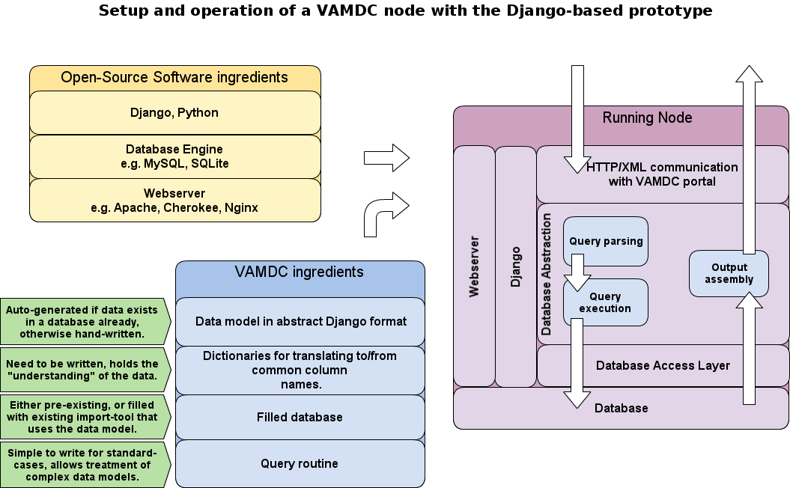

This document covers the NodeSoftware from the master branch of
https://github.com/VAMDC/NodeSoftware (Python 3.11+, Django 5.2). The
documentation is also part of that repository, in the directory ``doc/``,
where you can build it yourself with ``make html``.

.. _intro:

Introduction
=============

About VAMDC
-------------

The Virtual Atomic and Molecular Data Centre (VAMDC) connects databases of
atomic and molecular data so that they can be searched together. It started as
an EU FP7 research infrastructure project in 2009 and is now run by a
consortium of the participating institutes. You can read all about it on
https://vamdc.org/

VAMDC nodes
-------------

A "node" within VAMDC is a data service that offers its data using the
standards and protocols defined by the VAMDC. They are web services with a
simple API, the specification of which can be found in the documentation for
the VAMDC standards: https://vamdc.org/documents/standards/

The scope of this document is to serve as documentation for the 
reference implementation of such a service. The goal of this 
implementation is to serve as publishing tools for new data services, 
i.e. it is meant to be easily deployed at multiple nodes.

A versatile implementation of VAMDC standards
---------------------------------------------

Principle design decisions that were made to arrive at
this software package include

* *Open source*. No software licences need to be bought and the used 
  software can be adapted if needed.
* The data must exist in a *relational database*. If this is not the
  case yet, a tool for creating it is provided. 
* *Flexibility in the data structure*.
  The service should be able to be plugged on top of existing databases
  and therefore needs to cope with almost arbitrary internal data formats.
* *Re-usable code*. The implementation of the VAMDC standards and protocols
  themselves should not depend on the requirements of a specific node.

Since the last two points contradict each other in practice, there needs 
to be an intermediate layer of abstraction that hides the node-specific 
details like the database layout from the parts of code that are shared 
between nodes.

Our implementation of the VAMDC node software is therefore based on a 
framework called `Django <https://www.djangoproject.com/>`_ (which in 
turn is based on the programming language `Python 
<https://www.python.org>`_) that provides both the database abstraction 
layer and high level tools for implementing web services.

The ingredients for a VAMDC node based on this software package and its 
operation look schematically like this:

