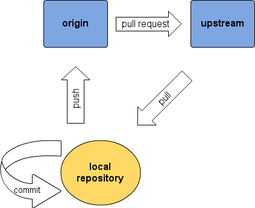

.. _source:

The Code
================

You can get the NodeSoftware with git::

    $ git clone https://github.com/VAMDC/NodeSoftware.git

or download it as a zip archive from
https://github.com/VAMDC/NodeSoftware/archive/refs/heads/master.zip

The master branch is the version that nodes should run; there are no separate
releases any more. Please see :ref:`upgrading` on how to keep it up to date.

The development repository resides at https://github.com/VAMDC/NodeSoftware and
you are welcome to use the version control software *git* to check out your own
copy. This takes a few more minutes to set up but has the benefit of
facilitating collaboration. After all, you might makes changes or extend the
code for your needs and we would like to include your improvements into the
main repository.

.. _gitcollab:

Collaborating with git and GitHub
-----------------------------------

Git is a decentralized version control system (http://git-scm.com/). This 
means among other things that:

* Each checked out copy of the code has the full version history.
* There is no central repository, all repositories ("repos") are equal (but some *can* be made more equal than others, as we'll see below).
* Commits happen locally into your working repo, no network connection needed.
* Repos are updated and synced with each other by pushing and pulling commits back and forth between them. 
* There are web-platforms that offer free web-repositories which
  facilitates syncing and merging. We'll use *GitHub* (https://github.com/).

The setup that we want looks like this:

* The **local repository** (also known as your "working copy") is your own workspace. This is where you do
  all your work. It offers you full local version control without
  necessarily having to upload the changes anywhere. We'll get to how you create your
  local repo in a minute.
* Your **origin** is an online version of your repository, stored online
  at GitHub. When you want to sync the two you need to *push* your
  latest local changes to origin. Once online, others will also be able to see the changes. 
* **Upstream** is a unique repository that serves as an online
  code "central" managed by VAMDC. It too is hosted on
  GitHub. Upstream serves as a convenient way to update your
  distribution; you should regularly *pull* the latest changes into your
  local repo to stay updated. Conversely, if you want your own changes
  to be incorporated into the central distribution you can send a
  *pull request* to upstream. The relevant commit(s) in your **origin**
  repo will be reviewed and will, if accepted, be merged into upstream
  so that others will get the changes next time they do a pull.
* You can certainly have **several local repositories**, e.g. one on your laptop, 
  one on your desktop and one on the server where the node runs. You 
  then use the online **origin** repository to keep them in sync. For example: You work 
  from your laptop and commit your changes locally. You then push them to 
  your origin repository. Next all you need to do is to tell your other local
  repos to pull from origin and they will all be synced. 
  
Now enough with theory, let's do this in practice. To create your own 
repositories (origin and local) do the following:

* Go to https://github.com and make an account. To push from the command
  line you also need to upload an ssh-key there (or use a token); simply follow
  the instructions on GitHub.
* Visit the repository at https://github.com/VAMDC/NodeSoftware and
  click "Fork" in the upper right corner. This will make a copy of the
  original repository under your account. This is your **origin** (see above).
  For more information on forking, you can read
  https://docs.github.com/en/pull-requests/collaborating-with-pull-requests/working-with-forks/fork-a-repo
* Github will give you instructions on how to *clone* your origin
  to your own computer, thereby creating a local repo, your **local
  repository**, aka your "working copy". 
* You can repeat the cloning on as many machines as you see fit.
* Tell your local repos where **upstream** is by running the following
  command in each of them: *git remote add upstream https://github.com/VAMDC/NodeSoftware.git*

Now that you are all set, a typical working session may look like this::

    $ cd $VAMDCROOT               # go to your local repo
    $ git status                  # should tell you you have a clean tree and are on the branch "master"
    $ git pull origin             # pull from your origin, in case you pushed things there from another of your local repos.
    $ git pull upstream master    # fetch the latest from upstream and merge it with your tree.
    $ git log                     # read the commit log about what is new.
    $ ....                    # edit your files
    $ git status                  # review which files have changed
    $ git diff                    # review details of your changes
    $ git diff <filename>         # see changes in one file only
    $ git add <filename>          # add a file to be committed with the next commit, e.g. a new file
    $ git commit -a -m "message"  # commit all changed files. ALWAYS check the status before you use -a to prevent that you commit unwanted files.
    $ git commit -m "message" <filenames>   # commit, but include only the named files in the commit    
    $ ....                   # more edits, more commits. until, at the end of day:
    $ git status                  # also tells you how many commits you are ahead of your origin
    $ git push                    # push all commits to your origin, also the new ones that came from upstream.

.. note::
    There are several graphical user interfaces available for git that
    will facilitate overview and some operations for the less 
    command-line adept, e.g. *gitk* which comes with git. Most editors also integrate with git so that you can handle the 
    version control from within the editor.

After you pushed your work to your origin, you can go to the *GitHub* 
website and send a *pull request* to the upstream repository, if you want 
your changes to be propagated to everybody else. We will then look at 
your commits and merge them.

A few dos and don'ts that are worthwhile to keep in mind with git:

* Do commit often. It goes instantly.
* Pull and push less often, but often enough. You certainly want to pull 
  from upstream before making changes, since you otherwise
  might work on outdated versions of files which
  will result in conflicts later. You also do not want to sit on your
  local commits for too long but push them frequently instead.
* Never pull into a dirty tree (i.e. one that has uncommitted changes). 
  Commit first, then pull. Alternatively read *git help stash*.
* Do *not* commit data files that you have put in your node directory.
  (check ``git status`` on what will be committed before you use ``git commit -a``.)
* *Git* trusts you know what you are doing. It will allow you to do stupid
  things, too.
* Don't panic. Yes, *git* may have a comparably steep learning curve, but it
  is a powerful tool and all problems can be resolved.

Situations that commonly arise and how to solve them
~~~~~~~~~~~~~~~~~~~~~~~~~~~~~~~~~~~~~~~~~~~~~~~~~~~~~~~~

**Merge conflicts.** When you pull from Upstream into your repo, other's 
changes are merged with yours. It might however happen that someone else 
has changed the same line in the same file as you have in one of your 
own commits, which results in a merge conflict. The pull commands warns 
you about this and *git status* shows the file in question as "both 
modified". The file itself contains both versions of the conflicting 
lines, clearly marked. Edit the file so that only one version remains 
and remove the markings. Then you simply commit the file (and push).

**Undo a commit.** To undo a commit means exactly that, *not* that any 
of the files change. For example, undoing the last commit leaves you 
with as much uncommitted changes as you had before your last commit. 
None of your edits is reversed. Undoing commits is practical e.g. when 
you have committed too many things at once or unwanted files; or when 
you want to split one commit into several. You undo a commit with *git 
reset --soft <REF>* where <REF> is the commit that should be reset to 
(i.e. the next-to-last one, if you want to undo your last commit). Common values for <REF> include:

* *HEAD^* - this is the next-to-last
* *HEAD^^* - the one before the next-to-last.
* *HEAD~5* - five commits back
* *111521cb9d3771e636f5f053d3d1048aa7c8852f* - each commit has a long 
  hash number that uniquely identifies it. They can be seen in *git log* 
  and you can give the hash number of the commit that you want to reset to 
  to *git reset*.

**Revert to an earlier version.** If you want to *throw away* your edits 
since a certain commit, you use *git reset --hard*. For example, to 
revert all files to the state that they were in at the last commit (throw 
away uncommitted changes), you do *git reset --hard HEAD*. Similarly to 
the soft reset, you can also specify earlier commits that you want to 
reset to.

**Look at an earlier version.** You can look at any earlier version of 
any file at any time. *git log <filename>* lists the commits that changed
it, and *git show <REF>:<filename>* prints the file as it was at commit
<REF>, with any of the <REF> mentioned above. *git restore --source=<REF>
<filename>* puts that version into your working copy, and *git restore
<filename>* throws away uncommitted changes in a file - a more gentle way
than the reset described above.

To go back in time with the whole repo, *git switch --detach <REF>*,
and *git switch master* brings you back to the latest. The book at
https://git-scm.com/book explains this and much more.

**Make a branch**. Read *git help branch* for this.

Commit guidelines
~~~~~~~~~~~~~~~~~~~~~~~~~

**One thing at a time.** Please commit often and only include things in 
one commit that logically belong together. For example, changes to your 
node and changes to the common library should not be in the same commit 
but committed separately.

**Meaningful commit messages.** This goes together with the previous: If 
you cannot meaningfully summarize the changes you want to commit in one 
or two lines, your commit is likely to be too large. Try to make the log 
messages meaningful!

**Good code.** Please try to avoid spaghetti-code, write modular, and follow https://peps.python.org/pep-0008/

**Pull first.** Before you send a pull request, please make sure that you 
have pulled from upstream. This will make the merging of your code 
easier, since it will be you who needs to resolve potential conflicts 
before you push to your origin again.

The admin of *upstream* (aka the writer of these lines) might be bribed 
and/or convinced to turn a blind eye on violations against any of the above 
points, but he will be very happy if you try to follow them.

Source code documentation
-------------------------------

The following is the automatically generated documentation from
the source code. It lists and describes all functions, classes etc.

The VAMDC-TAP service library
------------------------------

.. toctree::
   :maxdepth: 2

   vamdctap

The import tool
----------------
.. toctree::
   :maxdepth: 3

   imptools
   linefuncs
